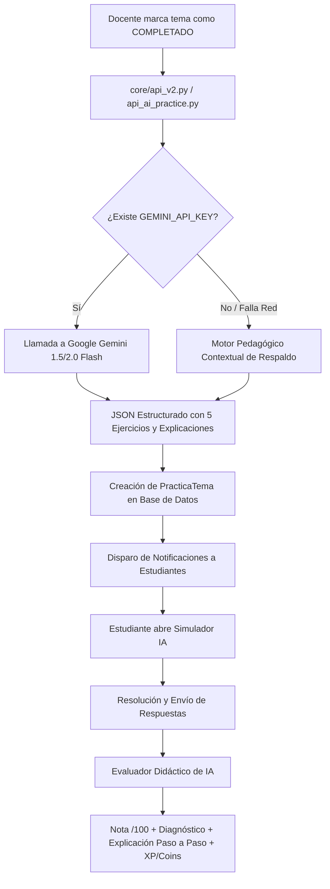
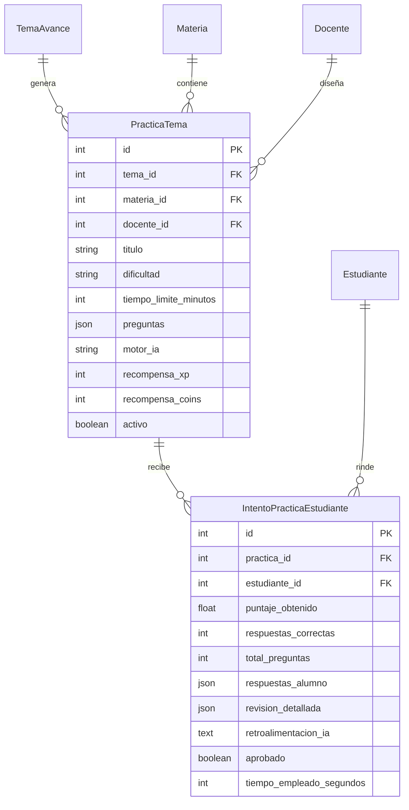

# INFORME TÉCNICO DE ARQUITECTURA DEL SISTEMA E INTEGRACIÓN DE INTELIGENCIA ARTIFICIAL — EDUSMART

**Proyecto:** EduSmart — Ecosistema de Gestión Académica y Aprendizaje Asistido por IA  
**Nivel Educativo:** Educación Regular (Secundaria y Bachillerato Escolar)  
**Fecha de Publicación:** 15 de Noviembre de 2026  
**Documento:** Informe Técnico de Arquitectura, Tecnologías y Módulo de IA  

---

## 1. RESUMEN EJECUTIVO

**EduSmart** es un ecosistema tecnológico diseñado para transformar la educación escolar mediante la integración de la gestión académica tradicional (asistencia, calificaciones, tareas, seguimiento curricular) con **Inteligencia Artificial generativa y pedagógica**.

El sistema resuelve la brecha entre la enseñanza en el aula y la preparación del estudiante para sus exámenes: **cada vez que un docente completa un tema curricular, el sistema genera automáticamente un simulador interactivo de examen con ejercicios didácticos**, explicaciones paso a paso de resolución y recompensas gamificadas, asegurando que los estudiantes afiancen sus competencias antes de una evaluación formal.

---

## 2. STACK TECNOLÓGICO Y LENGUAJES DE PROGRAMACIÓN

El sistema adopta una arquitectura desacoplada y moderna que separa la lógica de negocio y datos en el backend de la experiencia de usuario en el frontend.

```
┌────────────────────────────────────────────────────────┐
│               FRONTEND (React 18 + Vite)               │
│  - Single Page Application (SPA)                       │
│  - ExamSimulatorRunner & StudentPracticeView           │
│  - Panel Docente & Gamificación                        │
└───────────────────────────▲────────────────────────────┘
                            │  HTTP / JSON (REST API)
┌───────────────────────────▼────────────────────────────┐
│          BACKEND (Django 4.2 + Django REST)            │
│  - Módulo IA: Google Gemini 1.5/2.0 Flash REST Client  │
│  - Motor Pedagógico Contextual de Respaldo             │
│  - Autenticación, Roles y Reglas de Negocio            │
└─────────────────────▲─────────────────────▲────────────┘
                      │                     │
┌─────────────────────▼───────┐ ┌───────────▼────────────┐
│   BASE DE DATOS SQL (ACID)   │ │  NOSQL (MongoDB)       │
│   MySQL 8 / SQLite3          │ │  Logs de auditoría     │
│   Usuarios, Materias, Temas, │ │  y eventos en tiempo   │
│   Prácticas, Calificaciones  │ │  real                  │
└─────────────────────────────┘ └────────────────────────┘
```

### 2.1. Backend (Lado del Servidor)
* **Lenguaje:** **Python 3.9+** (Tipado, versátil y estándar de facto en Inteligencia Artificial).
* **Framework Principal:** **Django 4.2 LTS** (Garantiza seguridad contra ataques CSRF, XSS, inyecciones SQL y administración estructurada).
* **Capa de Servicios y API:** **Django REST Framework (DRF 3.16+)** para serialización de datos y endpoints RESTful desacoplados.
* **Manejo de Variables de Entorno:** `python-dotenv` para configuración segura de secretos y API keys.
* **Conectores de Base de Datos:** `mysqlclient` (MySQL nativo) y `pymongo 4.18+` (MongoDB).

### 2.2. Frontend (Lado del Cliente)
* **Lenguaje:** **JavaScript moderno (ES6+) y JSX**.
* **Librería de Interfaz:** **React 18** (Estructura modular basada en componentes y hooks funcionales: `useState`, `useEffect`, `useCallback`, `useMemo`).
* **Entorno de Compilación y Bundler:** **Vite 8** (Construcción ultrarrápida en menos de 1.5 segundos con Hot Module Replacement).
* **Iconografía:** **Lucide React** (Iconos vectoriales limpios y accesibles).
* **Estilos:** CSS3 modular con soporte de diseño responsivo (móvil y escritorio).

### 2.3. Persistencia Políglota (Bases de Datos)
* **Base de Datos Relacional (SQL):** **MySQL 8** (en producción/XAMPP) y **SQLite3** (en entorno local) estructurada en **Tercera Forma Normal (3NF)** para transacciones ACID, integridad referencial y auditoría de notas.
* **Base de Datos No Relacional (NoSQL):** **MongoDB** para eventos de alta concurrencia y registros time-series inmutables.

---

## 3. CÓMO SE IMPLEMENTÓ EL MÓDULO DE INTELIGENCIA ARTIFICIAL

El subsistema de Inteligencia Artificial fue diseñado para operar bajo dos principios innegociables:
1. **Calibración Estricta a Nivel Colegio:** El lenguaje, rigor y conceptos están adaptados a secundaria (Matemáticas, Lenguaje, Física, Química, Biología y Ciencias Sociales), descartando terminología universitaria no apta para estudiantes en etapa escolar.
2. **Disponibilidad Permanente (Zero Downtime):** Si no hay clave de API o si falla la conexión a internet, el sistema no se detiene; activa inmediatamente un **motor pedagógico contextual de respaldo**.



### 3.1. Conexión con Google Gemini (`core/ai_practice_service.py`)
La integración con Google Gemini se realiza directamente a través de la API REST oficial (`v1beta/models/gemini-1.5-flash:generateContent`), optimizando la latencia y eliminando dependencias de librerías externas pesadas.

#### Prompt Engineering Especializado para Colegio
El prompt instruye a Gemini para actuar como un profesor de secundaria con directrices pedagógicas estrictas:
```text
Actúa como un profesor de COLEGIO (Educación Secundaria) en la materia escolar "{materia}".
IMPORTANTE: Este contenido es exclusivamente para ESTUDIANTES DE COLEGIO.
El docente de colegio acaba de completar en el aula el siguiente tema escolar:
- TEMA: "{tema}"
- CURSO / NIVEL: "{nivel or 'Secundaria'}"
- DIFICULTAD ESCOLAR: {dificultad}

Diseña un simulador de examen escolar con exactamente {cantidad} ejercicios prácticos y didácticos.
Requisitos:
1. Enunciados claros y motivadores para adolescentes de colegio.
2. 4 opciones etiquetadas A), B), C), D).
3. Letra de la opción correcta.
4. Explicación paso a paso comprensible para un estudiante de colegio, explicando la regla, fórmula o procedimiento.
5. Formato JSON estricto.
```

### 3.2. Motor Pedagógico Contextual Escolar (Fallback Autónomo)
Para garantizar que el sistema funcione siempre (incluso en colegios con conectividad intermitente o sin presupuesto para API keys), se diseñó un motor algorítmico contextual en Python con bancos estructurados por materia:

* **Matemáticas Escolar:** Despeje de variables, regla de tres directa, simplificación de términos semejantes, leyes de signos y jerarquía de operaciones (PEMDAS).
* **Lenguaje y Literatura:** Clasificación y tilde en palabras agudas, graves y esdrújulas; identificación de Sujeto y Predicado; figuras literarias escolares (Símil, Hipérbole); signos de puntuación y tipos de texto.
* **Física Escolar:** Movimiento Rectilíneo Uniforme ($d = v \cdot t$), Segunda Ley de Newton ($F = m \cdot a$), aceleración gravitatoria terrestre ($g = 9.8\text{ m/s}^2$), caída libre y principio de inercia.
* **Química Escolar:** Estructura atómica (protones, neutrones y electrones), Grupos y Períodos de la Tabla Periódica, Ley de Conservación de la Masa (Lavoisier), enlaces covalentes y escala de pH (0 a 14).
* **Biología y Ciencias Naturales:** Función respiratoria celular de la mitocondria (ATP), fotosíntesis ($\text{CO}_2 \to \text{O}_2$), células eucariotas vs procariotas, glóbulos rojos (hemoglobina) y niveles tróficos.
* **Ciencias Sociales / Historia / Geografía:** Relieve de Bolivia (Altiplano, Valles, Llanos), causas de la independencia latinoamericana, la Constitución Política como ley suprema y valores cívicos democráticos.

### 3.3. Evaluador Didáctico y Retroalimentación Formativa
La función `evaluate_student_answers` procesa las respuestas del estudiante y:
1. Compara las alternativas seleccionadas contra las respuestas correctas.
2. Calcula la nota en escala de **0 a 100 puntos** (nota mínima de aprobación escolar: **51 puntos**).
3. Genera un **diagnóstico pedagógico personalizado** de acuerdo a la nota obtenida:
   * **$\ge 90$ pts:** *🌟 Rendimiento sobresaliente (listo para el examen formal).*
   * **$70 - 89$ pts:** *👏 Buen desempeño con recomendaciones de ajuste fino.*
   * **$51 - 69$ pts:** *⚠️ Aprobado con margen básico (se sugiere repaso).*
   * **$< 51$ pts:** *📚 Alerta de refuerzo preventivo antes del examen.*
4. Incluye la explicación **"¿Cómo se resuelve y por qué?"** en cada ejercicio para convertir el error en un momento de aprendizaje.

---

## 4. MODELO DE DATOS PARA LA IA

Se incorporaron dos modelos relacionales en `core/models.py` (Migración `0011`):



### Seguridad y Prevención de Trampas
Cuando un estudiante solicita un simulador mediante `GET /api/v2/practicas/<id>/`, el backend **sanitiza el JSON en memoria**, suprimiendo los campos `respuesta_correcta` y `explicacion`. De esta forma, aunque el alumno inspeccione las herramientas de desarrollador o tráfico de red, no puede ver las respuestas antes de contestar.

---

## 5. FLUJO DE FUNCIONAMIENTO COMPLETO (END-TO-END)

### Paso 1: El Docente Avanza en Clase
En el aula, el docente cubre una lección escolar (ej. *"Movimiento Rectilíneo Uniforme"*). Al ingresar a su panel en EduSmart, se dirige al **Gestor de Avance de Temas** y marca el tema como **`COMPLETADO`**.

### Paso 2: Generación Automática del Simulador
Al detectar el cambio de estado, el backend:
1. Invoca `generate_exam_practice(...)`.
2. Produce 5 ejercicios estructurados de nivel colegio con justificación analítica.
3. Almacena la `PracticaTema`.
4. Dispara una **Notificación interna** a todos los estudiantes inscritos en el curso y materia:
   > *"✨ Nuevo Simulador de Examen Disponible: Tu docente completó el tema 'MRU'. ¡Entra a practicar para tu examen!"*

### Paso 3: El Estudiante se Entrena para su Examen
1. El estudiante inicia sesión y ve la nueva sección **"Simuladores IA"** en su barra de navegación.
2. Encuentra las materias con temas completados por sus profesores.
3. Al hacer clic en **"🎯 Practicar para el Examen"**, se abre el componente `ExamSimulatorRunner`.
4. El estudiante responde con cronómetro activo, navegando entre preguntas.

### Paso 4: Calificación y Explicación Paso a Paso
Al presionar **"Finalizar y Calificar"**:
1. El backend evalúa las respuestas en menos de 100 milisegundos.
2. Si el alumno aprueba ($\ge 51$ pts), se le acreditan **+40 Puntos de Experiencia (XP)** y **+20 EduCoins**, actualizando su progreso en los retos y gamificación.
3. Se despliega la pantalla con la nota final, el diagnóstico de la IA y la **solución explicada de cada ejercicio** para que comprenda en qué falló y cómo resolverlo correctamente en su examen oficial.

### Paso 5: Monitoreo Docente
El docente puede visualizar en su panel cuántos estudiantes han realizado el simulador y cuál es el promedio de la clase, identificando oportunamente a los alumnos que necesitan reforzamiento antes de la evaluación presencial.

---

## 6. CONCLUSIÓN

La arquitectura implementada en **EduSmart** articula de forma armónica la gestión docente con la inteligencia artificial pedagógica. Al concentrarse en **materias y contenidos propios de la educación escolar (secundaria y bachillerato)** y contar con un motor de respaldo tolerante a fallos, el sistema proporciona una herramienta real, segura y aplicable a cualquier institución educativa.

